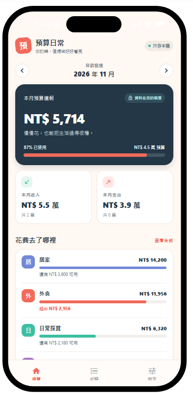
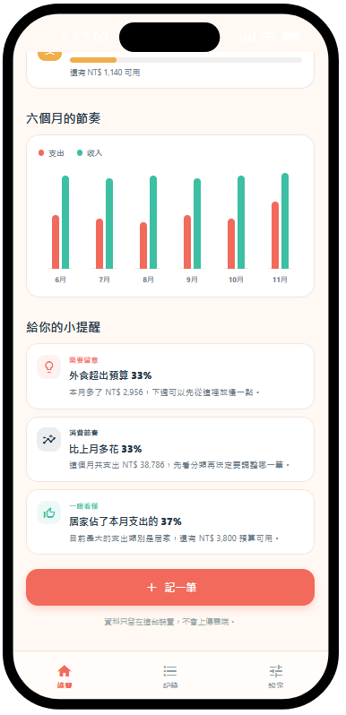
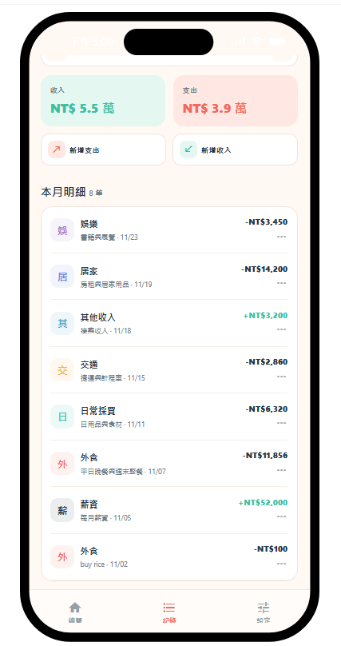
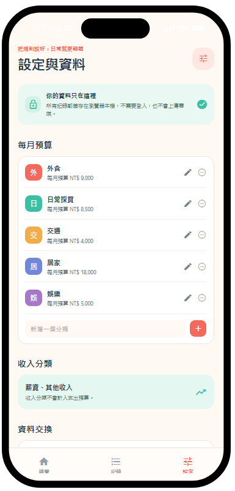
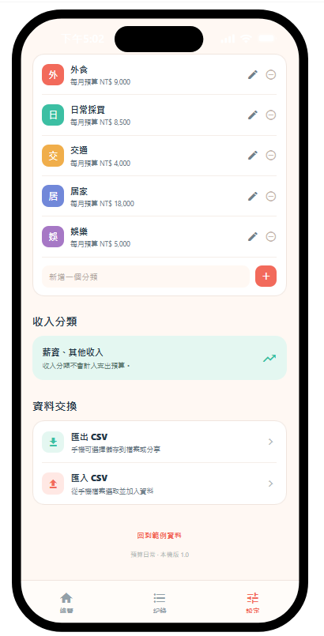

# 預算日常

**本 App 由斑彩市集 Ammolite.Life 工作團隊製作。**

**歡迎光臨市集網：https://ammolite.life** —— 舊物找新主人，面交最安心。預算日常是斑彩市集工作團隊為大家做的免費記帳工具。

預算日常是一款簡單好用的本機記帳 App，幫你把每天的收入和支出記下來，掌握生活花費與消費節奏。

## App 畫面

## 下載

只可以用在 Android 手機，不可以用在 iOS（iPhone、iPad 不能安裝）。

[點這裡直接下載 APK（v1.0.1，約 63MB）](https://github.com/lifebc143/budget-daily/releases/download/v1.0.1/AmmoliteLife-1.0.1.apk)

下載後直接安裝，不需要 Expo Go，也不用上 Google Play。也可以到本頁右側 **Releases** 下載。

## 功能

- **儀表板**：呈現當月財務概況——當月收入、支出與預算概況；當月剩餘可用金額與預算使用比例；各分類支出，包含已用金額、月預算與剩餘／超支狀態；逐月趨勢圖，比較不同月份的收入、支出與支出變化；並根據預算與消費資料產生簡潔易懂的提醒，例如「外食超出預算 32%」。
- **收入與支出管理**：可以依分類新增、編輯、刪除收入及支出紀錄；每筆紀錄包含日期、分類、金額與備註，並在清單中依月份查看。
- **分類與每月預算**：可以管理收支分類，為每個分類設定每月預算；儀表板會依分類計算每月已用金額、剩餘預算與使用比例。
- **CSV 資料交換**：支援交易與預算資料的 CSV 匯入與匯出；在 Android 原生環境中，匯出 CSV 會開啟系統分享選單，匯入 CSV 會開啟系統檔案選取器；匯入錯誤時會在畫面中提供清楚提示，不破壞現有資料。
- **本機資料保存**：所有資料只儲存在手機本機，無須登入或雲端帳戶即可使用，資料不會上傳雲端。

## 記帳方式

- 只有台幣記帳，繁體中文介面。
- App 內建範例資料，方便先看看畫面與功能；設定裡可以回到範例資料。

## 安裝方式

1. 在 Releases 下載 APK 檔案到手機。
2. 點開下載的 APK 檔案。
3. 如果 Android 跳出限制，允許瀏覽器或檔案管理員「安裝未知來源的應用程式」（只需允許一次）。
4. 點「安裝」，裝好後直接打開就能用。

## 備份

在 App 的「設定 → 資料交換」裡可以匯出 CSV 備份，建議定期匯出、另外保存；換手機時再用「匯入 CSV」還原。

## 關於斑彩市集

斑彩市集（Ammolite.Life）是由 Ammolite.Life 工作團隊經營的二手市集，歡迎光臨市集網：https://ammolite.life

## 版本

- v1.0.1（本機版 1.0）
